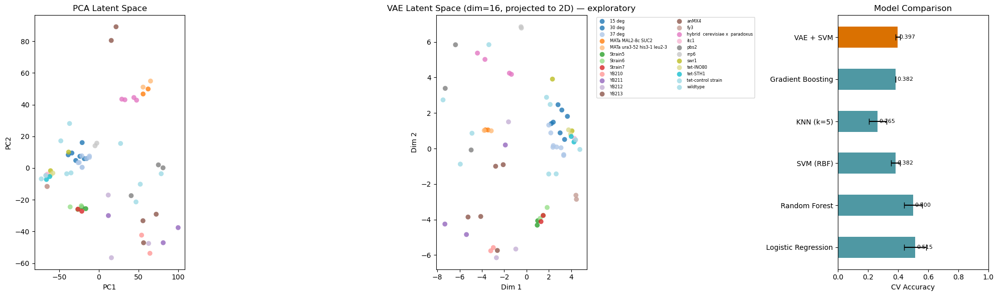
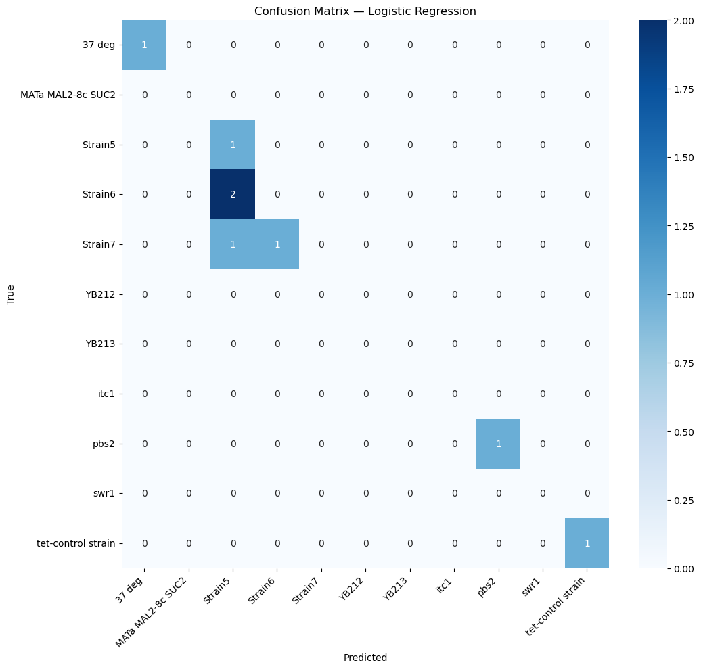

# Yeast Gene Expression Condition Classification

Can a model tell *what happened to a yeast cell* — heat shock, a gene knockout, a different strain — just from which genes are switched on? This project compares classical ML against a deep generative model (VAE) on a tiny, very high-dimensional dataset, then checks whether the most predictive genes make biological sense.

## 🎯 Research question
Can ML models trained on genome-wide *S. cerevisiae* expression profiles classify samples by experimental condition — and do the most predictive genes map to meaningful Gene Ontology categories?

## 📊 Data
- Expression matrix: **6,071 genes × 92 samples**
- Condition annotations (temperature treatments, knockouts, strains)
- GO labels for 5,786 genes across Biological Process, Cellular Component, and Molecular Function

## 🧹 Preprocessing
- Transposed genes × samples → samples × genes
- Normalized label aliases (`wild type` vs `wildtype`)
- Resolved duplicate IDs: kept consistent technical replicates, **dropped samples with conflicting labels**
- Removed single-sample classes → **68 samples, 23 classes**
- Variance filtering + z-score scaling

## ⚙️ Methods
**Pipeline A — PCA + classical models:** VarianceThreshold → StandardScaler → PCA (95% variance) → Logistic Regression / Random Forest / SVM / KNN / Gradient Boosting

**Pipeline B — VAE + SVM (PyTorch):** 256 → 64 → 16-d latent encoder; latent means used as features for an RBF SVM

**Leak-free CV:** scaling *and* VAE training are re-fit inside every fold, so the deep model never sees test data.

## ✅ Results

| Model | CV accuracy |
|---|---|
| **Logistic Regression (PCA)** | **0.515 ± 0.074** |
| Random Forest (PCA) | 0.500 ± 0.059 |
| VAE + SVM | 0.397 ± 0.015 |
| SVM (RBF) | 0.382 ± 0.029 |
| Gradient Boosting | 0.382 |
| KNN (k=5) | 0.265 ± 0.059 |

Random chance with 23 classes is ~4.3%, so ~51.5% reflects strong condition-specific signal.

**Takeaways**
- **Simple beat complex.** With 68 samples, a regularized linear model on PCA features outperformed the VAE — deep models need more data to pay off.
- **The model learns real biology.** Conditions with well-characterized signatures — 37 °C heat shock and the *pbs2* knockout — were the ones the model reliably picked out.
- **Signal is distributed.** Gene importance scores were nearly flat across the top 100 genes; only the root GO term reached significance (FDR < 0.05). Several **lncRNAs** ranked highly — worth a follow-up.



**Hold-out check:** refit on 80% and tested on a 14-sample hold-out, the best model got 4 of 14 right — perfect on 37 °C, *pbs2* and tet-control, but confused the closely related Strain5/6/7 groups. A test set that small is too noisy to trust, which is why CV is the headline metric.



## ⚠️ Limitations
Small sample size (2-fold CV only), heterogeneous labels, VAE variance across seeds, and coarse GO annotations. Results are predictive, not causal.

## 🚀 Future work
Pull in more GEO/ArrayExpress data · hierarchical classification · sparse models (LASSO) for cleaner gene sets · conditional VAE · full-hierarchy GO / GSEA


## ▶️ Run it
```bash
pip install -r requirements.txt
jupyter notebook notebooks/yeast_ml.ipynb
```
